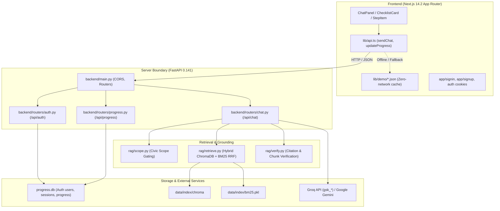

# NagarSetu Implementation Baseline

**Date:** 2026-10-25  
**Starting Commit Hash:** `e793283` ("Updated project files")  
**Working Branch:** `fix/security-reliability-hackathon`  
**Execution Environment:** Windows (PowerShell), Python 3.14.6, Node.js v26.5.0, npm 11.17.0

---

## 1. Verified Architecture & Components

---

## 2. Directory Structure & Key Files

- `backend/main.py`: FastAPI entrypoint, loads `.env`, configures CORS middleware, registers routers.
- `backend/routers/auth.py`: Comprehensive PBKDF2 authentication with TOTP 2FA, session cookie management (`nagarsetu_session`), and preferences.
- `backend/routers/chat.py`: POST `/api/chat` route handling scope validation, hybrid retrieval, prompt construction, LLM generation, grounding verification, and fallback.
- `backend/routers/progress.py`: POST/GET `/api/progress` for procedure step completion tracking. *(Baseline finding: originally relied on client-provided `session_id` without authenticated ownership validation).*
- `backend/db/progress.py`: SQLite connection and schema (`sessions`, `progress`).
- `backend/rag/retrieve.py`: Hybrid search fusing ChromaDB vector distance with BM25Okapi using Reciprocal Rank Fusion ($k=60$).
- `backend/rag/verify.py`: Enforces citation existence against retrieved chunks and procedural consistency.
- `backend/rag/scope.py`: Out-of-scope intent guardrail returning structured refusal responses before invoking LLMs.
- `frontend/lib/api.ts`: API client managing chat requests, retries, demo mode toggles, and offline bundled cache.
- `frontend/app/page.tsx`: Core civic assistant interface with procedure checklists, chat, and step progression.

---

## 3. Initial Baseline Audit & Pre-existing Issues

1. **Exposed Credentials & Sensitive Artifacts in Repository**:
   - Both root `.env` and `backend/.env` contained raw Groq API keys (`gsk_*`).
   - `.env.example.txt` contained identical exposed credentials.
   - `progress.db`, `backend/node_modules/`, `frontend/.next/`, and `uvicorn.log` were tracked in Git.
2. **Missing Dependencies on Initial Clone**:
   - `chromadb` and `sentence-transformers` were not present in the runtime environment.
   - Frontend `node_modules` was unpopulated on initial clone.
   - `data/index/chroma` and `bm25.pkl` index had not been compiled.
3. **Authorization Boundary Gaps**:
   - `/api/progress` accepted arbitrary `session_id` strings without validating authenticated identity, allowing unauthenticated or cross-session state changes.
4. **Offline & Fallback Transparency**:
   - `sendChat()` in `frontend/lib/api.ts` returned fallback demo data on server errors with a boolean property, but UI clarity required strengthening to guarantee fallback data is never mistaken for live municipal guidance.

---

## 4. Initial Test Execution Results

- **Backend Tests (`pytest`)**: 15 passed after installing dependencies and indexing (9 auth tests, 4 chat contract tests, 4 retrieval tests).
- **Frontend Production Build (`next build`)**: Succeeded (15 routes generated with zero compilation errors).
